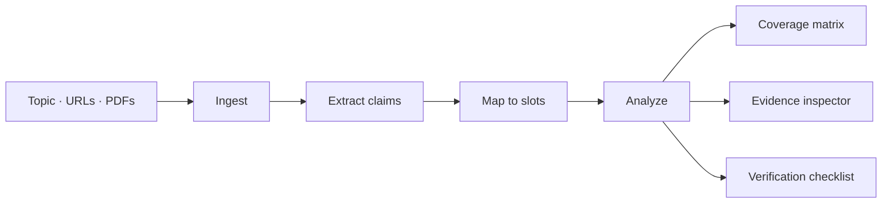
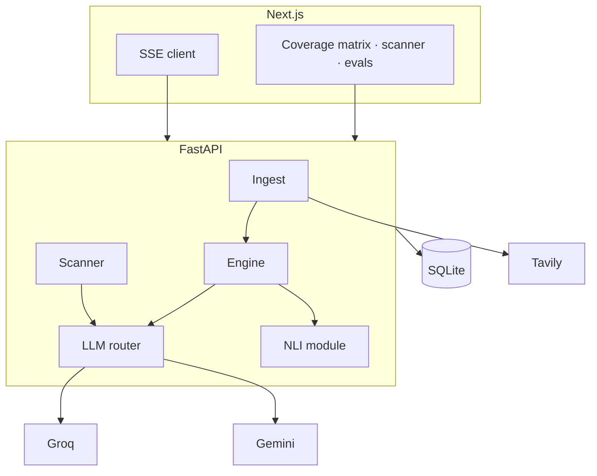

<h1 align="center">Lemma</h1>
th
<p align="center">
  <em>Don't just read your sources. See what they left in the dark.</em>
</p>

<p align="center">
  
  
  
</p>

<p align="center">
  <a href="#the-problem">Problem</a> ·
  <a href="#how-lemma-solves-it">Solution</a> ·
  <a href="#innovation">Innovation</a> ·
  <a href="#tech-stack">Tech stack</a> ·
  <a href="#folder-structure">Structure</a> ·
  <a href="#quick-start">Quick start</a>
</p>

---

## Built for the Shinchan Online Hackathon

**Lemma** is the submission of **Team Devengers** for the **Shinchan Online Hackathon: 24-Hour Hackathon**.

A lemma, in mathematics, is a proved supporting claim. **Lemma** does the same thing to the web: it extracts claims from your sources, then proves, dates, contradicts, or leaves them visibly dark.

> **One-liner:** Lemma audits sources the way an auditor audits accounts — it declares what a decision *needs* to know, then shows exactly which of those requirements your sources cover, contradict, date, or leave blank — with evidence linked to every finding.

---

## The problem

People make high-stakes decisions — scholarships, admissions, benefits, careers, policy — from scattered pages that **conflict**, go **outdated**, **omit** conditions, and leave questions **unanswered**.

Search engines *find* information. Summarizers *condense* it. Neither answers:

| Question people actually need | What they get today |
|---|---|
| What information is **missing**? | A fluent paragraph that sounds complete |
| Do sources **contradict** each other? | One blended “summary” |
| Is this **outdated**? | The newest page, not the current fact |
| Is this **complete enough to act on**? | Confidence without a checklist |

Lemma answers those questions **from evidence**, not from an LLM narrative.

---

## How Lemma solves it

Lemma inverts the usual AI-research question.

Instead of *“what do these sources say?”* it asks:

> **Which requirement slots remain empty — and why?**

### Decision as a schema

A decision needs a finite set of facts — **requirement slots**: eligibility, deadline, documents, award amount, renewal, process, exclusions, official portal.

1. **Ingest** — question, URLs, PDFs, screenshots, or auto-search via Tavily.
2. **Extract** — atomic claims with exact quotes, spans, and normalized values (dates, amounts, thresholds).
3. **Map** — claims land on slots. Empty slots are the product, not an afterthought.
4. **Analyze** — conflicts, gaps, and staleness become **computed properties of a coverage matrix**, inspectable in the UI.



### What you see

- **Live pipeline** — `Ingest → Extract → Map → Analyze`, with a typed event feed (search, fetch, claims, mapping, conflicts, gap probes).
- **Coverage matrix** — one card per slot: coverage bar + conflict / stale / gap / multi-source badges. Empty slots render as literal **dark spots**.
- **Evidence inspector** — every finding opens quotes, URLs, parsed values, and location in the original page.
- **Pooled re-run** — untick a source; the matrix recomputes from cached claims. Remove the only source holding a fact and the slot goes dark — proving gaps are *computed*, not narrated.
- **Source Red-Flag Scanner** — paste one URL; Lemma verifies check-worthy claims against independent evidence and returns Refuted / Unsupported / Undated / Corroborated.

### Honesty rules (non-negotiable)

1. **“Not found” ≠ “does not exist.”** Absence is always scoped to reviewed sources and search effort.
2. **Refuted requires counter-evidence.** Conflicts stay *possible* until both sides have receipts.
3. **Every finding is traceable:** quote → source URL → location.
4. **No confident written verdicts.** The matrix and badges carry the conclusion.
5. Five evidential states everywhere: supported · contradicted · potentially outdated · not found in reviewed sources · unverified.

---

## Innovation

Lemma’s originality is **slot-filling flipped**: the *empty* cells are the product.

| Usual AI research tools | Lemma |
|---|---|
| Summarize what is present | Surface what is **absent** |
| LLM writes a verdict | Findings are **computed** from a matrix |
| Conflicts get smoothed over | Tiered detection: **rules → NLI → LLM judge** |
| “Not found” after one search | 2–3 **reworded gap probes** before declaring a dark spot |
| Opaque agent logs | **SSE run trace** you can reopen anytime |
| Trust the model | **Pooled re-run** proves the math: drop a source, watch a slot go dark |

**Conflict engine (hybrid, not LLM-only)**

1. **Deterministic** — parsed dates / amounts / deadlines compared programmatically (zero hallucination surface).
2. **NLI screen** — Hugging Face `nli-deberta-v3-base`, verdicts cached.
3. **LLM judge** — only survivors; labelled *possible conflict* until evidence-backed.

This follows the same hybrid pattern as recent conflict-detection research: LLMs alone fail to localize contradictions; NLI + rules + a judge localizes them with receipts.

**Transparency as a feature** — the user watches searches fire, sources land with word counts and tiers, claims accumulate, slots fill, and gap probes retry. Structured events only. No token-stream theatre.

**Free-tier proof** — Groq primary, Gemini fallback + vision, Tavily search, HF Inference for NLI/embeddings. No paid APIs required to demo.

---

## Product surfaces

| Surface | What it does |
|---|---|
| Landing (`/`) | Playfair Display wordmark, hero, pipeline story, evals proof |
| Dashboard (`/dashboard`) | Ask a decision question; watch the run feed live |
| Run detail (`/runs/[id]`) | Coverage matrix, evidence, checklist, run trace |
| Scanner (`/scan`) | Single-URL red-flag report |
| Evals (`/evals`) | Gold-pack scoreboard — conflict, gap, stale, clean cases |

**Target users:** students and professionals making document-bound decisions (scholarships, admissions, benefits, tenders), and anyone checking whether a claim-heavy page is trustworthy.

---

## Tech stack

Built in 24 hours on a contract-first protocol: `contracts/api_schema.py` + `contracts/mock_json/` freeze before UI or engine work.

| Layer | Choice |
|---|---|
| **Frontend** | Next.js 16, React 19, TypeScript, Tailwind CSS 4, shadcn/ui, Motion, Radix dropdown |
| **Typography** | **Playfair Display** (italic wordmark) · **Instrument Serif** (editorial headings) |
| **Backend** | FastAPI, Pydantic v2, SQLAlchemy, Uvicorn, httpx |
| **Ingest** | trafilatura (HTML) · PyMuPDF (PDF) · Gemini 2.5 Flash vision (images) |
| **LLM** | Groq `llama-3.3-70b` (primary) → Gemini 2.5 Flash (fallback + vision) via `llm_router.py` |
| **NLI / embeddings** | HF Inference API (`nli-deberta-v3-base`, `all-MiniLM-L6-v2`) · TF-IDF cosine degrade path |
| **Search** | Tavily (gather, gap probes, scanner verification) |
| **Realtime** | Server-Sent Events — persist then stream, replay on reconnect |
| **Voice** | Web Speech API (browser-native) |
| **Storage** | SQLite |
| **Evals** | Gold pack + `evals/run_evals.py` |

Deliberately unused: vector databases, LangGraph, local GPU models, production auth — extra risk without payoff in a 24-hour window.



---

## Folder structure

```text
lemma/
├── contracts/                 # Frozen API contract (frontend reads, does not invent)
│   ├── api_schema.py
│   └── mock_json/             # Mock payloads for UI-first development
├── backend/
│   ├── ingest/                # fetch, gather, HTML/PDF/image, dates, tiers
│   ├── engine/                # claims, slots, mapping, scoring, analysis
│   ├── scanner/               # F2 source red-flag loop
│   ├── sse/                   # live pipeline event bus
│   ├── db/                    # SQLAlchemy models
│   ├── llm_router.py          # Groq → Gemini failover
│   ├── nli_module.py          # HF NLI + cache
│   ├── routers/api.py
│   └── main.py
├── frontend/
│   ├── public/images/         # landing hero background
│   └── src/
│       ├── app/               # landing, dashboard, scan, runs, evals
│       ├── components/
│       │   ├── landing/       # how-it-works, trust, FAQ, CTA
│       │   ├── ui/            # shadcn + chat input
│       │   ├── app-shell.tsx
│       │   └── lemma-logo.tsx
│       ├── lib/api.ts
│       ├── mocks/
│       └── types/api.ts
├── evals/
│   ├── gold_pack/cases.json   # labelled conflict / gap / stale / clean
│   └── run_evals.py
├── LEMMA_PRD.md
├── LEMMA_TRD.md
└── README.md
```

---

## Quick start

**Requirements:** Python 3.11+, Node.js 20+, keys in `.env` (never commit `.env`).

```bash
git clone https://github.com/animatrix01/lemma.git
cd lemma
```

### 1. Backend

```bash
copy .env.example .env          # Windows
# cp .env.example .env          # macOS / Linux
# fill GROQ_API_KEY, GEMINI_API_KEY, TAVILY_API_KEY, HF_TOKEN

pip install -r requirements.txt
uvicorn backend.main:app --host 127.0.0.1 --port 8000
```

Health check: `GET http://127.0.0.1:8000/health`

### 2. Frontend

```bash
cd frontend
npm install
npm run dev
```

Open [http://localhost:3000](http://localhost:3000).

Frontend talks to `http://localhost:8000` by default (`NEXT_PUBLIC_API_BASE`). Optional mock mode: `NEXT_PUBLIC_MOCK_MODE=true`.

### Environment (server-side only)

| Key | Role |
|---|---|
| `GROQ_API_KEY` | Primary LLM |
| `GEMINI_API_KEY` | Fallback + vision OCR |
| `TAVILY_API_KEY` | Search, gap probes, scanner |
| `HF_TOKEN` | NLI + embeddings |

The Next.js app never receives these keys. All model and search calls stay in FastAPI.

---

## Evals

Gold-pack cases live in `evals/gold_pack/cases.json` and are shown on `/evals`.

On the labelled set of conflict, gap, and stale cases, Lemma reports **95.5 F1** (96% precision, 95% recall) — published on the evals page so the number is auditable, not marketing copy.

---

## Team Devengers

Built for **Shinchan Online Hackathon: 24-Hour Hackathon** by **Team Devengers**.

Lemma is an AI-assisted **information-gap detection** platform — a *Digital Dark Spot* detector for decisions that cannot afford a missing clause.

<p align="center">
  <sub>Lemma · Team Devengers · Shinchan Online Hackathon</sub>
</p>
